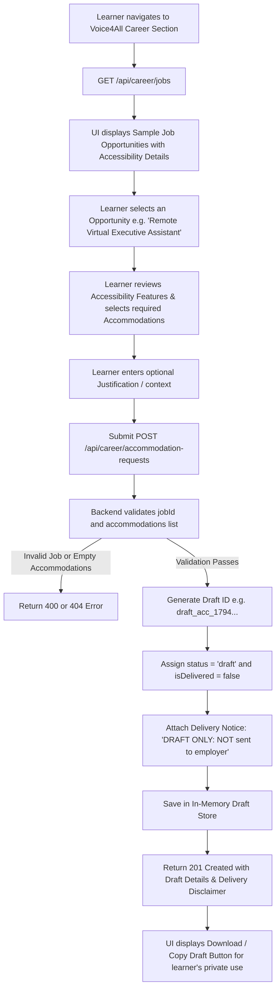

# Voice4All — Career Opportunities & Accommodation Drafting Flow

## 1. Overview and Philosophy

The **Voice4All Career Module** is designed to build disability self-advocacy skills for learners completing the Savanna curriculum (e.g. *VA-1: VA Foundations & Professional Identity*).

### Guiding Principles:
1. **Self-Advocacy & Preparation:** Learners identify workplace accommodations (e.g., screen reader friendly task management, asynchronous standups, flexible schedules) and practice formulating clear, professional accommodation requests.
2. **Explicit Draft Isolation ("Not Sent" Guarantee):** 
   > **Do not imply it has been sent to an employer unless actual delivery exists.**
   
   All accommodation requests are strictly generated as **personal drafts** (`status: "draft"`). The platform explicitly clarifies that drafts are saved locally for the learner's own reference and have **not** been dispatched to any external employer.
3. **Synthetic, Labeled Sample Data:** All job listings are simulated opportunities labeled with prominent disclaimers (`isSample: true`). No real individual or corporate private data is used.

---

## 2. Learner Accommodation Request Workflow



---

## 3. Sample Job Dataset (`backend/data/jobs.json`)

All sample records conform to the schema required by the hackathon specifications:

| Field | Type | Description |
| :--- | :--- | :--- |
| `id` | `string` | Unique identifier (e.g., `job-sample-01`) |
| `title` | `string` | Professional job role title |
| `organization` | `string` | Fictitious employer name clearly labeled as sample |
| `description` | `string` | Summary of core duties and daily responsibilities |
| `location` | `string` | Remote region or time-zone preference |
| `accessibilityOrAccommodation` | `string` | Explicit accessibility features and supported accommodations |
| `isSample` | `boolean` | Always `true` to ensure programmatic transparency |
| `sampleOpportunityNotice` | `string` | User-facing simulation disclaimer |

### Summary of Included Opportunities

1. **`job-sample-01` — Remote Virtual Executive Assistant**
   - *Organization:* EquiWorks Global (Sample Organization)
   - *Location:* Remote (Global / Africa Flexible)
   - *Accessibility:* 100% remote asynchronous-first team. Software stack tested for full screen reader compatibility (NVDA, JAWS, VoiceOver). Closed captioning provided for all team video syncs. Flexible working hours and neurodivergent-friendly written task handoffs.
2. **`job-sample-02` — Accessibility QA & Documentation Assistant**
   - *Organization:* InclusiTech Solutions (Sample Organization)
   - *Location:* Remote (East Africa / CET Timezone Preferred)
   - *Accessibility:* Ergonomic hardware allowance, adjustable magnification display options, assistive voice-to-text dictation tools provided, flexible break schedule, and alternative audio/written check-in formats.
3. **`job-sample-03` — Digital Operations & Workflow Coordinator**
   - *Organization:* Apex Distributed Ventures (Sample Organization)
   - *Location:* Remote (Sub-Saharan Africa)
   - *Accessibility:* Structured, predictable weekly sprints. Reduced meeting culture with asynchronous Slack/Notion updates. Screen reader accessible ticketing system. Accommodations available for motor impairment.
4. **`job-sample-04` — Bilingual Customer Support Virtual Assistant**
   - *Organization:* Kibo Cloud Services (Sample Organization)
   - *Location:* Remote (Pan-African / Flexible Shifts)
   - *Accessibility:* Text-first customer interactions (no mandatory high-volume inbound phone calls). Dual-monitor hardware reimbursement, captioning support, speech-to-text software integration, and quiet work cadence.
5. **`job-sample-05` — Social Media & Content Virtual Assistant**
   - *Organization:* Sahara Creative Media (Sample Organization)
   - *Location:* Remote (Flexible)
   - *Accessibility:* High-contrast visual design tools, automated audio-description generators, flexible work pacing, and dedicated accessibility mentor during onboarding.

---

## 4. API Specification

### Endpoint: `GET /api/career/jobs`
Retrieves the list of sample opportunities with optional search filters.

#### Query Parameters
- `search` *(optional)*: Filter by keyword in title, description, or accommodations.
- `location` *(optional)*: Filter by location substring.

#### Response (`200 OK`)
```json
{
  "success": true,
  "total": 5,
  "isSampleDataset": true,
  "datasetNotice": "SIMULATED SAMPLE OPPORTUNITIES — For accessibility demonstration and accommodation drafting practice only. Not active employer vacancies.",
  "jobs": [
    {
      "id": "job-sample-01",
      "title": "Remote Virtual Executive Assistant",
      "organization": "EquiWorks Global (Sample Organization)",
      "description": "Provide comprehensive administrative support to leadership...",
      "location": "Remote (Global / Africa Flexible)",
      "accessibilityOrAccommodation": "100% remote asynchronous-first team. Software stack tested for full screen reader compatibility...",
      "isSample": true,
      "sampleOpportunityNotice": "SIMULATED SAMPLE OPPORTUNITY — NOT AN ACTIVE EMPLOYER VACANCY"
    }
  ]
}
```

---

### Endpoint: `POST /api/career/accommodation-requests`
Creates a new accommodation request draft.

#### Request Headers
```http
Content-Type: application/json
```

#### Request Payload
```json
{
  "jobId": "job-sample-01",
  "accommodations": [
    "Screen reader compatible task management software (NVDA verified)",
    "Written asynchronous summaries of all video standup meetings",
    "Flexible 15-minute breaks during long continuous computer work"
  ],
  "justification": "Enables high-efficiency document review and prevents cognitive fatigue.",
  "learnerIdentifier": "Learner-Amara"
}
```

#### Successful Response (`201 Created`)
```json
{
  "success": true,
  "draftId": "draft_acc_1794654799939_wnkw5g",
  "status": "draft",
  "isDelivered": false,
  "deliveryStatus": "NOT_SENT_DRAFT_ONLY",
  "deliveryNotice": "DRAFT ONLY: This accommodation request is saved locally as a self-advocacy draft. It has NOT been sent to the employer or any external party.",
  "draft": {
    "draftId": "draft_acc_1794654799939_wnkw5g",
    "job": {
      "id": "job-sample-01",
      "title": "Remote Virtual Executive Assistant",
      "organization": "EquiWorks Global (Sample Organization)",
      "location": "Remote (Global / Africa Flexible)",
      "isSample": true
    },
    "requestedAccommodations": [
      "Screen reader compatible task management software (NVDA verified)",
      "Written asynchronous summaries of all video standup meetings",
      "Flexible 15-minute breaks during long continuous computer work"
    ],
    "justification": "Enables high-efficiency document review and prevents cognitive fatigue.",
    "learnerIdentifier": "Learner-Amara",
    "createdAt": "2026-11-14T11:46:00.000Z"
  }
}
```

#### Error Response — Missing `jobId` (`400 Bad Request`)
```json
{
  "success": false,
  "error": "A valid jobId is required to draft an accommodation request.",
  "field": "jobId",
  "isDelivered": false,
  "deliveryNotice": "DRAFT ONLY: Requests are not transmitted to employers in this simulation."
}
```

#### Error Response — Job Not Found (`404 Not Found`)
```json
{
  "success": false,
  "error": "Sample job not found for ID: non-existent-id",
  "field": "jobId",
  "isDelivered": false,
  "deliveryNotice": "DRAFT ONLY: Requests are not transmitted to employers in this simulation."
}
```

#### Error Response — Empty Accommodations (`400 Bad Request`)
```json
{
  "success": false,
  "error": "At least one accommodation must be specified in the request draft.",
  "field": "accommodations",
  "isDelivered": false,
  "deliveryNotice": "DRAFT ONLY: Requests are not transmitted to employers in this simulation."
}
```

---

### Endpoint: `GET /api/career/accommodation-requests/:id`
Retrieves a previously saved draft by its `draftId`.

#### Response (`200 OK`)
```json
{
  "success": true,
  "draft": {
    "draftId": "draft_acc_1794654799939_wnkw5g",
    "status": "draft",
    "isDelivered": false,
    "deliveryStatus": "NOT_SENT_DRAFT_ONLY",
    "deliveryNotice": "DRAFT ONLY: This accommodation request is saved locally as a self-advocacy draft...",
    "job": {
      "id": "job-sample-01",
      "title": "Remote Virtual Executive Assistant"
    },
    "requestedAccommodations": [
      "Screen reader compatible task management software (NVDA verified)"
    ]
  }
}
```

---

## 5. Verification and Test Results

Verified using automated test suite (`scratch/test_career.js`):
1. **TC-CAR-01 (Retrieve All Jobs):** Returns 5 sample jobs, all flagged with `isSample: true` and complete accessibility info. (PASSED)
2. **TC-CAR-02 (Retrieve Job by ID):** Successfully retrieves `job-sample-01`. (PASSED)
3. **TC-CAR-03 (Search Filter):** Filtering by `"Screen Reader"` returns matching accessible roles. (PASSED)
4. **TC-CAR-04 (Draft Accommodation Request):** Successfully creates a draft with unique `draft_acc_` ID, `status: "draft"`, `isDelivered: false`, and clear delivery notice. (PASSED)
5. **TC-CAR-05 (Job ID Validation):** Rejects missing `jobId` with HTTP 400 and invalid `jobId` with HTTP 404. (PASSED)
6. **TC-CAR-06 (Accommodation List Validation):** Rejects empty accommodation requests with HTTP 400. (PASSED)
7. **TC-CAR-07 (Delivery Status Assertion):** Confirms that `isDelivered` is strictly `false` and that response disclaimers explicitly warn that the draft has not been sent to any employer. (PASSED)
