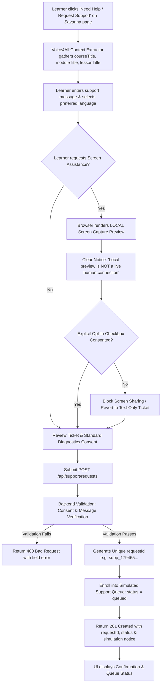

# Voice4All — Human Support Workflow & Consent Architecture

## 1. Overview and Operational Philosophy

The **Voice4All Support Module** bridges Savanna learners with support services while upholding strict privacy, accessibility, and transparency standards:

1. **Explicit Learner Consent:** Remote screen sharing and diagnostic data transmission are strictly opt-in. A local screen-capture preview does **not** equal remote transmission.
2. **Transparent Simulation Notice:** In accordance with hackathon guidelines, all automated queueing, triage, and mock agent assignment mechanisms are prominently labeled as **simulated support**.
3. **Automated Context Enrichment:** Learner tickets automatically incorporate current course metadata from `assets/js/voice4all/context.js`, minimizing manual typing.

---

## 2. End-to-End Support Workflow

The diagram below illustrates the learner journey, consent checkpoints, and backend processing:



---

## 3. Screen Sharing Consent & Local Preview Boundary

### The Critical Distinction
A common dark pattern in support widgets is implying that opening a screen-sharing preview connects the user directly to a live human. Voice4All enforces a strict architectural boundary:

1. **Local Screen-Capture Preview:** When a user selects *"Show my screen"*, the browser uses `navigator.mediaDevices.getDisplayMedia()`. This video feed is displayed strictly inside a local `<video>` or `<canvas>` element for the learner to inspect what is visible. **No network packets or video frames are transmitted to any server or third party.**
2. **Affirmative Consent Gate:** Transmission of screen diagnostics requires explicit confirmation via an unambiguous, unchecked-by-default toggle:
   ```json
   {
     "screenShareRequested": true,
     "screenShareConsent": true,
     "consentedAt": "2026-11-14T11:45:00.000Z"
   }
   ```
3. **Rejection Policy:** If `screenShareRequested === true` but `screenShareConsent !== true`, the backend rejects the request with HTTP `400 Bad Request`:
   > *"Screen sharing requires explicit learner consent. A local screen-capture preview is not a real human support connection."*

---

## 4. API Specification

### Endpoint: `POST /api/support/requests`

#### Request Headers
```http
Content-Type: application/json
```

#### Request Payload Schema
```json
{
  "message": "I am unable to see the submit button on the Quiz page.",
  "language": "en",
  "context": {
    "courseTitle": "VA-1: VA Foundations & Professional Identity",
    "moduleTitle": "Module 2: What is a VA",
    "lessonTitle": "The Future of the VA Industry",
    "lessonText": "Optional excerpt or summary..."
  },
  "consent": {
    "screenShareRequested": false,
    "screenShareConsent": false,
    "contextSharingConsent": true,
    "diagnosticsConsent": true
  }
}
```

#### Field Specifications
| Field | Type | Required | Description |
| :--- | :--- | :--- | :--- |
| `message` | `string` | **Yes** | Clear description of the learner's question or issue (non-empty). |
| `language` | `string` | No | Learner's preferred language (defaults to `"en"`). |
| `context` | `object` | No | Extracted Savanna context object. |
| `consent` | `object` | **Yes** | Learner consent flags. If screen sharing is requested, `screenShareConsent: true` is strictly required. |

#### Successful Response (`201 Created`)
```json
{
  "success": true,
  "requestId": "supp_1794654690923_9e3u61",
  "status": "queued",
  "isSimulated": true,
  "simulationNotice": "SIMULATED HUMAN SUPPORT: This ticket has been placed into the Voice4All demonstration support queue. A local screen-capture preview does not establish a live human connection.",
  "estimatedWaitMinutes": 4,
  "queuePosition": 1,
  "ticket": {
    "requestId": "supp_1794654690923_9e3u61",
    "status": "queued",
    "language": "en",
    "context": {
      "courseTitle": "VA-1: VA Foundations & Professional Identity",
      "moduleTitle": "Module 2: What is a VA",
      "lessonTitle": "The Future of the VA Industry"
    },
    "consent": {
      "screenShareRequested": false,
      "screenShareConsent": false,
      "contextSharingConsent": true,
      "diagnosticsConsent": true,
      "consentedAt": "2026-11-14T11:45:00.000Z"
    },
    "createdAt": "2026-11-14T11:45:00.000Z"
  }
}
```

#### Error Response — Missing Message (`400 Bad Request`)
```json
{
  "success": false,
  "error": "A support message is required.",
  "field": "message",
  "isSimulated": true,
  "simulationNotice": "A local screen-capture preview is not a real human support connection."
}
```

#### Error Response — Missing Screen Share Consent (`400 Bad Request`)
```json
{
  "success": false,
  "error": "Screen sharing requires explicit learner consent. A local screen-capture preview is not a real human support connection.",
  "field": "consent",
  "isSimulated": true,
  "simulationNotice": "A local screen-capture preview is not a real human support connection."
}
```

---

### Endpoint: `GET /api/support/requests/:id`
Retrieves ticket status, queue position, and simulated agent assignment.

#### Response (`200 OK`)
```json
{
  "success": true,
  "ticket": {
    "requestId": "supp_1794654690923_9e3u61",
    "status": "queued",
    "isSimulated": true,
    "simulationNotice": "SIMULATED HUMAN SUPPORT: This ticket has been placed into the Voice4All demonstration support queue...",
    "estimatedWaitMinutes": 4
  }
}
```

---

### Endpoint: `GET /api/support/faqs`
Retrieves curated FAQs with optional `?category=...` or `?search=...` query filters.

#### Example Request
```http
GET /api/support/faqs?search=screen+sharing
```

#### Response (`200 OK`)
```json
{
  "success": true,
  "total": 1,
  "faqs": [
    {
      "id": "faq-02",
      "category": "Support & Screen Sharing",
      "question": "Does granting screen capture start a live call with a human immediately?",
      "answer": "No. A local screen-capture preview only renders your screen locally in your browser for you to verify what is visible. No live human connection is established, and your screen is never transmitted without your separate, explicit consent and an active agent session.",
      "tags": ["screen-sharing", "consent", "privacy", "simulation"]
    }
  ]
}
```

---

## 5. Verification and Test Cases

The support workflow is verified against the following test scenarios:

1. **TC-SUPP-01 (Standard Ticket Creation):** Valid message, language, and context submitted. Returns HTTP 201 with unique `requestId`, `status: "queued"`, and `isSimulated: true`. (PASSED)
2. **TC-SUPP-02 (Empty Message Validation):** Submitting empty string or missing message returns HTTP 400 with message field validation error. (PASSED)
3. **TC-SUPP-03 (Screen Share Consent Enforcement):** Submitting `screenShareRequested: true` without explicit `screenShareConsent: true` fails immediately with HTTP 400. (PASSED)
4. **TC-SUPP-04 (Consented Screen Share):** Submitting with affirmative consent succeeds and records consent metadata with timestamp. (PASSED)
5. **TC-SUPP-05 (Ticket Retrieval by ID):** Verifies ticket can be retrieved by ID with status details. (PASSED)
6. **TC-SUPP-06 (FAQ Querying):** Retrieves relevant FAQs on screen sharing, navigation, and accessibility. (PASSED)
